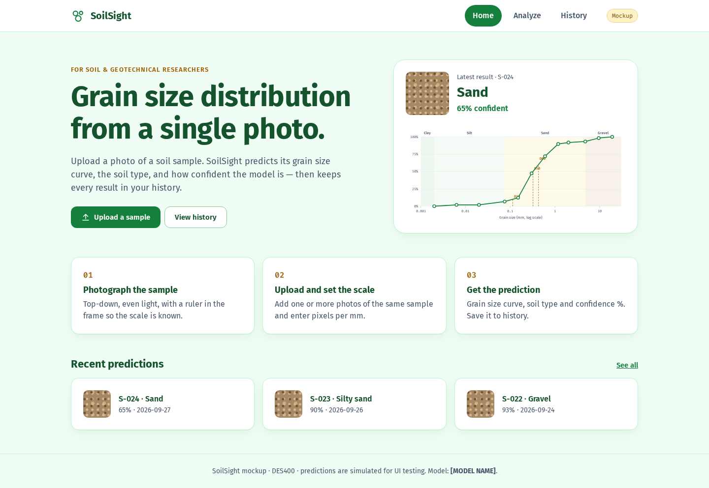
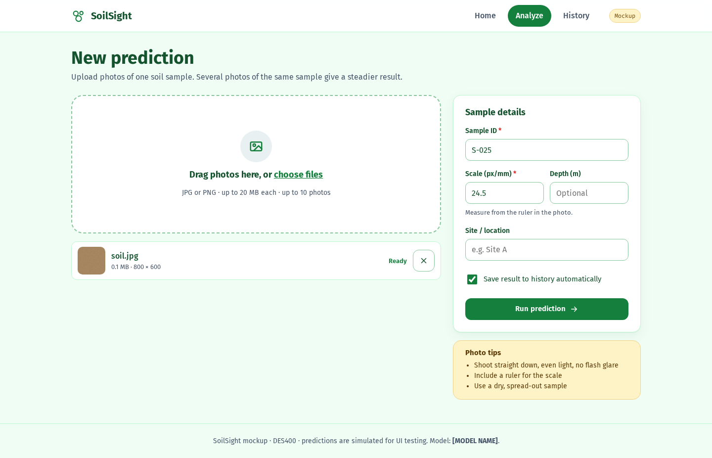
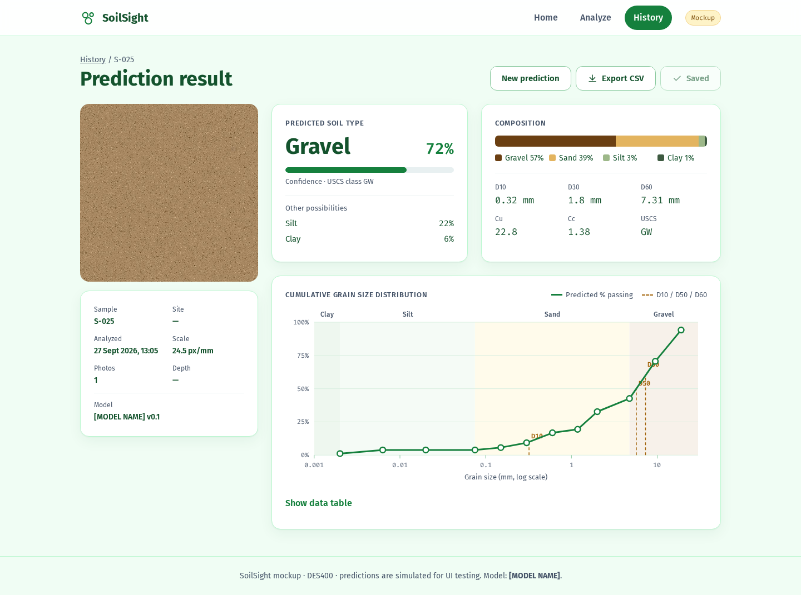
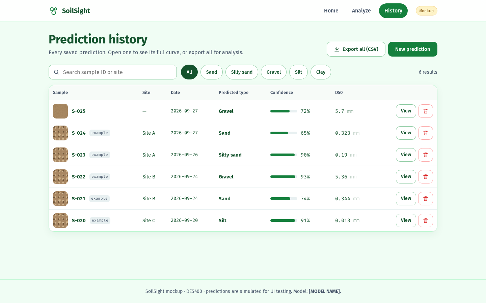

# SoilSight — soil grain size mockup (DES400)

A clickable, coded mockup of a web app that predicts the **grain size distribution of soil from a photo**.
It is based on the Kaggle task [Predicting Soil Grain Size Distributions from Images](https://www.kaggle.com/competitions/soil-grain-size-from-photos)
(see also [this notebook](https://www.kaggle.com/code/mdismielhossenabir/predicting-soil-grain-size)).

> **Predictions are simulated.** The UI is real; the "model" is a stand-in so every screen can be tested.
> Swap `mockPredict()` in `js/data.js` for a call to the real model API.

## Flow

```
Home ──► Upload picture ──► Prediction result ──► (Save) ──► Prediction history
                                    ▲                              │
                                    └────────── View ◄─────────────┘
```

| Screen | What it does |
|---|---|
| **Home** | What the tool does, latest result, 3-step guide, recent predictions |
| **Upload** | Drag & drop or choose photos (JPG/PNG/WebP, ≤ 20 MB, ≤ 10), sample ID, scale (px/mm), depth, site, inline validation |
| **Analyzing** | Progress overlay with 4 stages |
| **Result** | Soil type + **confidence %**, other possibilities, gravel/sand/silt/clay %, D10/D30/D60, Cu, Cc, USCS class, cumulative curve (hover/keyboard tooltips + data table), Save, Export CSV |
| **History** | Search, filter by soil type, view, delete with undo, export all as CSV, empty states. Stored in the browser (localStorage) |

## Screenshots

| Home | Upload | Result | History |
|---|---|---|---|
|  |  |  |  |

Mobile versions are in `docs/screenshots/mobile-*.png`.

## Run it

No build step, no dependencies.

```bash
python3 -m http.server 8000
# open http://localhost:8000
```

Or turn on **GitHub Pages** (Settings → Pages → Deploy from branch → `main` / root).

## Project structure

```
index.html                  app shell + nav
favicon.svg                 browser icon
css/styles.css              design tokens + all styles
js/data.js                  soil math (D-values, Cu, Cc, USCS), mock model, storage
js/chart.js                 SVG grain size curve
js/app.js                   hash router + the 4 views
design-system/soilsight/    design system generated with the ui-ux-pro-max skill
docs/screenshots/           desktop + mobile screenshots
```

## Design

Generated with the **ui-ux-pro-max** skill (`--design-system`, see `design-system/soilsight/MASTER.md`):

- Style: Organic Biophilic — rounded 16–24 px cards, soft natural shadows
- Colors: earth green `#15803D` (primary), harvest gold `#A16207` (accent), `#F0FDF4` background
- Type: Fira Sans (UI) + Fira Code (numbers/data)
- UX rules applied: 44 px touch targets, visible labels + inline errors, visible focus, skip link,
  no emoji icons (inline SVG), line chart with data-table fallback and a mobile scroll cue, empty states,
  undo for delete, `prefers-reduced-motion`, responsive 375 → 1440 px with no page-level overflow
  (history table turns into cards on mobile)

## Next steps

- Choose the model (e.g. a CNN regressor that outputs % passing at each sieve size) and replace `[MODEL NAME]`
- Add a backend: `POST /predict` (photos + scale) → curve + class + confidence; `GET/POST /history`
